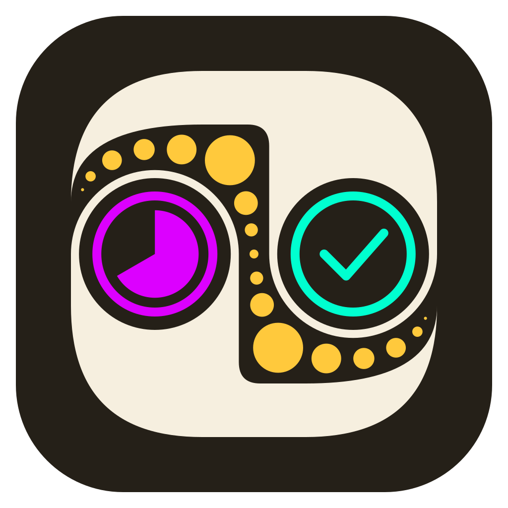
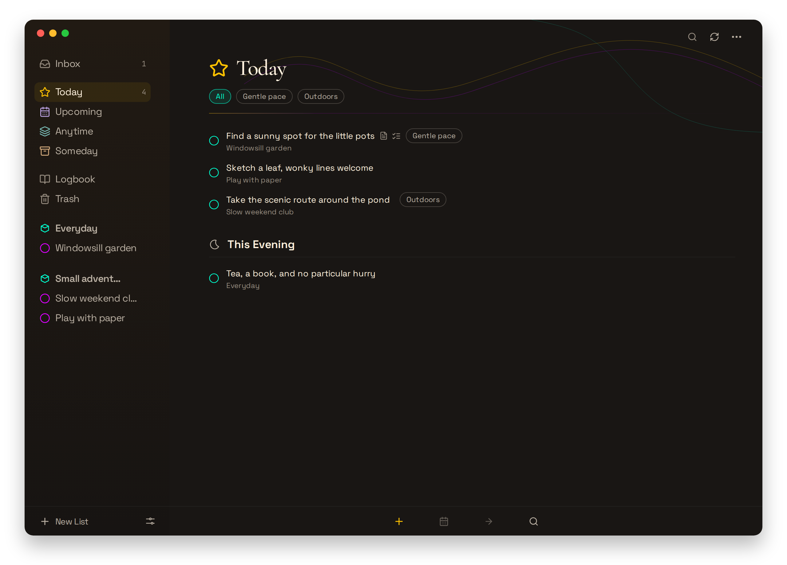
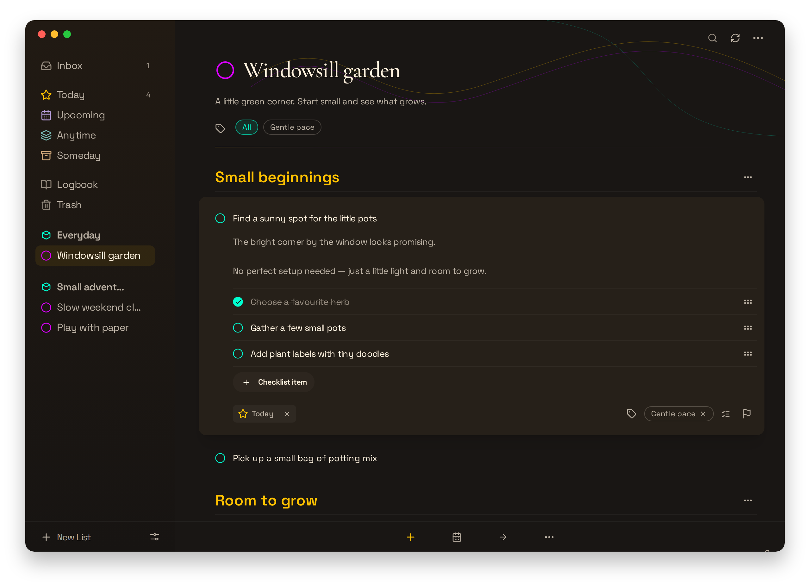
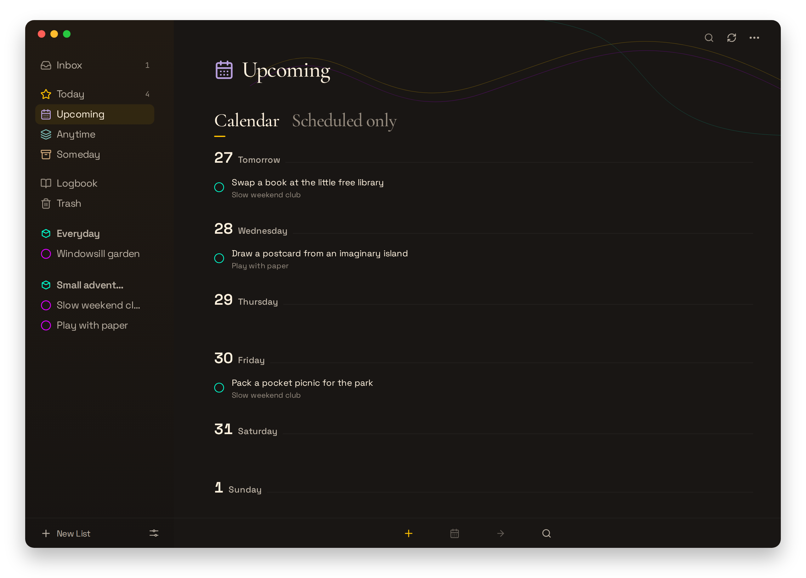
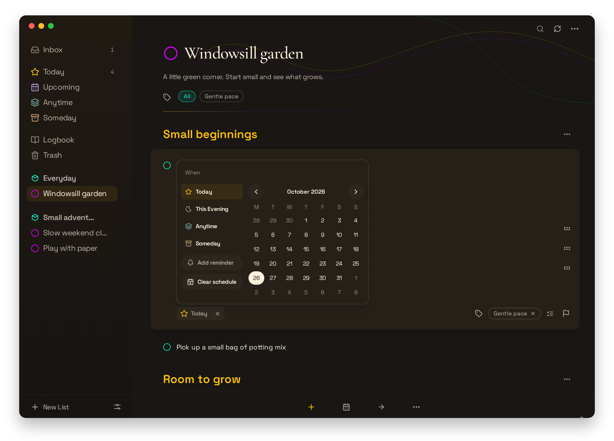

# Somedue

A native macOS task manager with optional Things Cloud sync.

Somedue helps you organize tasks into projects and areas, plan what to do today,
and keep the rest for later. Use it on its own with local storage, or connect your
Things Cloud account to work with your existing tasks.

**Very early stage and fully vibe-coded.** Somedue is not yet at alpha stage.
It is built entirely with AI coding agents. Expect rough edges, incomplete features,
and breaking changes. Features and data formats may change without migration support.

Somedue is an independent, open-source project and is not affiliated with or
endorsed by Cultured Code, the makers of Things.



*Today, with fictional tasks. All screenshots use synthetic data and a decorative macOS window frame.*

## What it does

- **Plan your day:** Inbox, Today, Upcoming, Anytime, Someday, Logbook, and Trash.
- **Organize your work:** projects, areas, headings, tags, and manual ordering.
- **Add the details:** Markdown notes, checklists, start dates, and deadlines.
- **Stay on the keyboard:** Quick Find, inline editing, and Quick Entry with an
  optional global shortcut.
- **Work locally or sync:** tasks and pending edits are stored in SQLite on your
  Mac; optional Things Cloud sync includes conflict and draft recovery controls.
- **Set local reminders:** notifications fire while Somedue is running.

Click a to-do to select it. Press Enter or double-click to edit it; click empty
space to clear the selection. Drag checklist items by their right-hand handles,
or use Option ↑ / ↓ while editing an item.

### Projects and details

Keep a project in small steps, with notes and a checklist when you need them.



### Plan ahead

Upcoming gives scheduled tasks a place in the days ahead.



### Schedule a task

Choose a start date without leaving the task you're editing.



## Current limitations

Somedue does not yet implement everything Things can do. Advanced repeating-task
rules, calendar and Apple Reminders import, multiple main windows, and native
automation are incomplete. Simple daily, weekly, monthly, yearly and
after-completion rules create copies locally. Advanced imported rules, repeating
projects and newer opaque repeaters still require Things. Reminders created in
Somedue are local and do not sync to other devices.

Only macOS is supported. Things Cloud access uses an unofficial protocol, and the
app is not notarized. Test it with nonessential data before relying on it.

## Run from source

You need macOS 13 or later, [Bun 1.4.3](https://bun.sh),
[Rust and Cargo 1.99.1](https://www.rust-lang.org/tools/install), and Apple's Xcode
Command Line Tools (`xcode-select --install`). These are the versions used in CI.

```sh
git clone https://github.com/Heartkemy/somedue.git
cd somedue
bun install --frozen-lockfile
cargo fetch --locked --manifest-path src-tauri/Cargo.toml
bun run tauri dev
```

The native app supports local tasks immediately. To sync an existing account, open
**Settings → Things Cloud** and connect with your Things Cloud credentials. Local
and cloud workspaces stay separate; connecting does not upload your local tasks.
Passwords and the Cloud history access token are stored in macOS Keychain rather
than the task database.

For a frontend-only preview, run `bun run dev`. Browser previews cannot access
native task storage or Things Cloud.

### Build and install on macOS

Release builds that save Cloud credentials need a persistent code-signing
certificate in your login Keychain. List available identities with:

```sh
security find-identity -v -p codesigning
```

Set `SOMEDUE_CODESIGN_IDENTITY` to the chosen certificate's 40-character SHA-1
fingerprint, then package and install:

```sh
export SOMEDUE_CODESIGN_IDENTITY="YOUR_40_CHARACTER_CERTIFICATE_FINGERPRINT"
bun run install:macos
```

The packaging script generates icons, builds the app, stages its signed Keychain
helper, verifies signatures, and installs `/Applications/Somedue.app`. It backs up
an existing Somedue installation before replacing it, then quits the old instance
normally and opens the updated app. Save any open edits before running it.

Once signing is configured, `bun run install:macos` is the one-shot update command.
It builds the current working files, including uncommitted changes; no commit or
branch switch is required. Without a configured
certificate, it produces an ad-hoc local build that cannot save Cloud credentials.

### Local ad-hoc preview DMGs

To create separate Apple Silicon and Intel preview artifacts without using a
certificate, run:

```sh
bun run package:macos
```

The command produces target-specific `.app` bundles, DMGs, SHA-256 values, and
receipts under `out/macos/ad-hoc/arm64/` and
`out/macos/ad-hoc/x86_64/`. It verifies each app after packaging and again from a
read-only mounted DMG, including its code signature, every bundled Mach-O slice,
third-party notices, and the ad-hoc Keychain boundary on the native host target.
The target Rust standard libraries must already be installed; the script does not
download or configure a toolchain for you.

These previews are ad-hoc signed and not notarized. They cannot save Things Cloud
credentials, and are intended for local or synthetic data only. Gatekeeper may
block an unnotarized build; the package deliberately does not remove quarantine
attributes, disable Gatekeeper, or change macOS security policy. An Intel build
made on Apple Silicon is structurally inspected only: Rosetta is not native Intel
coverage, and macOS 13 has not been runtime-tested merely because it is the
declared minimum system version.

For the nonpublishing release rehearsal and the gated Cask preparation process,
see [the macOS release guide](docs/macos-release.md). Ad-hoc preview DMGs are not
eligible for public Homebrew Cask publication.

You can also store the fingerprint in
`~/Library/Application Support/Somedue/macos-signing-identity`.
For a signed release, the credential helper verifies the app before handling
credentials and does not expose them through command arguments or logs.

## Development

Somedue uses Tauri 2 and Rust for its native backend, Solid and TypeScript for the
interface, Tailwind CSS for styling, and Bun for frontend tooling.

### UI styling

Import shared controls from `src/ui.tsx`; their implementations live in `src/ui/`.
`Button` and `IconButton` own their size and variant styles. `Input` and `Textarea`
offer a `plain` variant for writing surfaces. Their `class` props use
`tailwind-merge`, so caller utilities can override defaults without CSS overrides.
Use `Button align="content"` to align its contents while preserving hover padding.
`NavigationItem` and `ListHeading` share navigation geometry and list hierarchy.
`UnderlineTab` uses serif labels and a growing active underline.
Use `Field`, `Dialog`, `Select`, `Menu`, `Checkbox`, `Kbd`, and `SectionHeading`
for the corresponding shared UI patterns.

Use Tailwind's spacing, typography, radius, and breakpoint scales for layouts.
`src/style.css` holds the palette, fonts, theme variants, and global Tailwind base
rules for focus, scrollbars, and reduced motion. Custom CSS requires an exceptional
need that Tailwind cannot cover; document that reason beside the rule. Existing
classes such as `task-row` also serve as behavior/test hooks. Measured sidebar
widths and viewport-aware popup positions remain runtime values.

### Checks

To refresh the README screenshots, run `bun run screenshots` with Docker running.
The capture uses a fixed date and isolated, fictional tasks from
[`tests/browser/readme-screenshots.ts`](tests/browser/readme-screenshots.ts).
Review the generated PNGs in `docs/screenshots/` after visible UI changes.
The capture hides the browser-only preview notice and adds rounded macOS-style
frames, traffic-light controls, and shadows only to the documentation images.

```sh
bun run build          # TypeScript check and production frontend build
bun test tests         # Model, motion, and editor-save tests
bun run test:native    # Rust tests; requires cached Cargo dependencies
bun test scripts/app-icon.test.mjs
bun run test:ui:docker # Chromium and WebKit checks in the matching Playwright image
```

The native test runner and packaging script use
`~/Library/Caches/Somedue/cargo-target` by default. Set `CARGO_TARGET_DIR` to use a
different location; a local filesystem avoids Rust archive issues on shared VM
mounts.

For browser interaction tests:

```sh
bunx playwright install chromium webkit
bun run test:ui
```

These tests use isolated in-memory task fixtures. They do not access your task
database or Things Cloud. On macOS with a configured signing identity, run
`bun run test:keychain` for the synthetic credential-boundary tests and
`bun run test:installed` to check the installed app's Keychain operations. The
installed-app check reads the fingerprint from the identity file described above.

## Contributing

Bug reports and focused pull requests are welcome. Read
[CONTRIBUTING.md](CONTRIBUTING.md) before opening a pull request. Report security
vulnerabilities through [SECURITY.md](SECURITY.md), not a public issue.

## License

[MIT](LICENSE) © 2026 Rafael Horvat.
